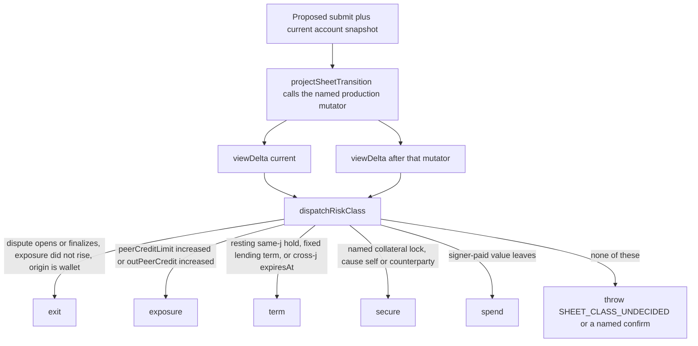
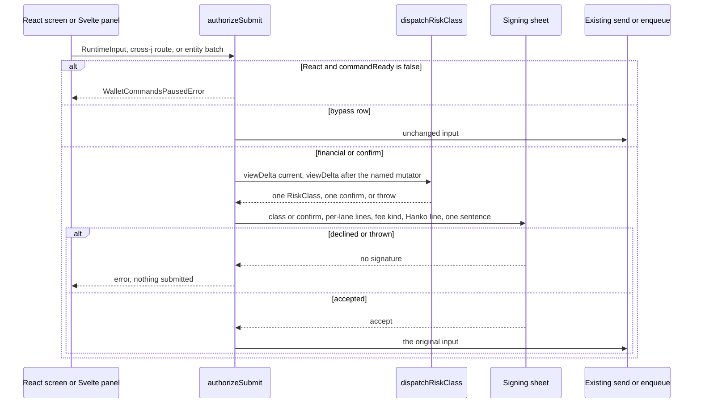
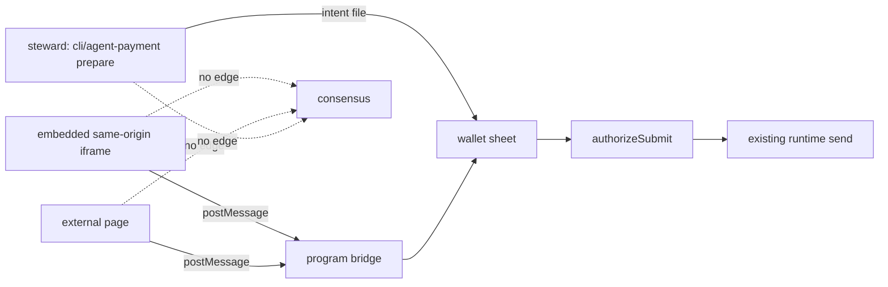

# XLN Wallet Signing Sheets, Surface Boundary, and Client XLN Programs

| | |
|---|---|
| Status | Draft |
| Author | design-doc-writer (Grok design loop d59b486b) |
| Date | 2026-11-19 |
| Tree | `8f8a4a6a` (release authority is committed `HEAD:AGENTS.md`; the working tree `AGENTS.md` differs and is not the authority) |
| Wallets | React `ui/` at `/ui/`, Svelte `frontend/` at `/app` |
| Consensus | No change. No `frozen-core.json` edit. No new `AccountTx` or `EntityTx` kind. |

## Overview

Both wallets submit financial `EntityTx`s straight into the canonical runtime. The only shared gate, React `RuntimeCommandGate` and Svelte `RuntimeCommandGateBanner`, reports sync readiness. It is not consent. The first hub `openAccount` also extends 10,000 USD of credit with no question. A program, a form button, or that onboarding path can therefore present an exposure increase as a payment, a fee ceiling as an exact fee, or skip the question entirely.

The change is a wallet-local sheet in front of the submit functions that already reach the runtime. One pure function reads two `deriveDelta` views and returns exactly one risk class: `spend`, `exposure`, `secure`, `term`, or `exit`. Unknown transitions throw. The sheet copy for money leaving is a finality sentence. The sheet copy for collateral that remains is a different survival sentence, and that survival sentence depends on who locks. Fee ceilings stay ceilings. A Hanko signature short of threshold is a proposal, not an execution. Batches render one line per lane.

Phase A lands that gate inside the wallets as they are. Phase B lets `embedded`, `external`, and `steward` programs propose intents into the same gate. Programs do not get a second submit path, a second account formula, or a way to sign unilateral exit.

## Background & Motivation

`RuntimeCommandGate` (`ui/src/components/RuntimeCommandGate.tsx`, 60 lines) returns null once `commandReady` is true. React mounts it from `ui/src/App.tsx:54` for the whole shell. Its Svelte counterpart is `frontend/src/lib/components/Entity/payments/RuntimeCommandGateBanner.svelte`, mounted from `EntityPanelTabs.svelte`. That banner is display. Svelte `submitRuntimeInput` does not throw `WalletCommandsPausedError`. That class exists only in `ui/src/runtime/commands.ts`.

React's fan-in is `sendRuntimeInput` (`ui/src/runtime/commands.ts:33`). The readiness check is first (`commands.ts:40`). Embedded mode then returns `adapter.send(input)` at `commands.ts:43` and never reaches `submitRuntimeCommand`. `sendEntityTxs` (`ui/src/runtime/tx.ts`) and `sendEntity` (`ui/src/runtime/hosted.ts:112`) both use `sendRuntimeInput`.

Svelte `submitRuntimeInput` (`frontend/src/lib/stores/xlnStore.ts:1712`) is a one-line wrapper around `submitActiveRuntimeInput` (`xlnStore.ts:1634`). `submitActiveEntityInputs` (`xlnStore.ts:1704`) calls `submitActiveRuntimeInput` directly. `submitEntityInputs` (`xlnStore.ts:1754`) calls `submitActiveEntityInputs`. Dispute, swap cancel, `requestCrossJurisdictionClear`, move drafts, `profile-update`, `settle_approve`, and add-token use that path. `routeRuntimeInput` (`xlnStore.ts:1500`) reaches `xln.enqueueRuntimeInput` at `xlnStore.ts:1570`, or `runtimeAdapterSend` at `xlnStore.ts:1565` when the embedded adapter owns the env. `dispatchRuntimeInputToRuntimeEnv` (`xlnStore.ts:1683`) calls `xln.enqueueRuntimeInput` at `xlnStore.ts:1698` and does not go through `submitActiveRuntimeInput`. Callers are `vaultStore.ts:740` (`enqueueAndAwait`) and `entityFactory.ts:95`. `registerDebugSurface` (`xlnStore.ts:1761`) exposes `submit: submitActiveRuntimeInput`.

Same-j swap uses `submitRuntimeInput` of `planSwapCommand(...).runtimeInput` (`SwapPanel.svelte:2595`, React `submitSwapPlan` at `ui/src/runtime/financial/swap.ts:196`). Cross-j does not. React `submitSwapPlan` (`swap.ts:201-208`) may `sendRuntimeInput(plan.targetSetupInput)` and then `adapter.submitCrossJurisdictionIntent`. Svelte `SwapPanel.svelte:2575-2585` does the same with `submitRuntimeInput(targetSetupInput)` and `submitActiveCrossJurisdictionIntent` (`xlnStore.ts:1719`), which calls `adapter.submitCrossJurisdictionIntent` and never `enqueueRuntimeInput`.

`cli/agent-payment.ts` does not use either choke point. `sendAgentPayment` in `core/api/payments/agent.ts` calls `adapter.send` on a prepared intent file.

The silent credit path is the same helper in both wallets. `getHubOpeningCredit` (`frontend/src/lib/utils/onboarding/onboardingPreferences.ts:211`) is `usdToRawTokenAmount(10_000, tokenId)`, which calls `wholeUsdToTokenAmount` (`core/jurisdiction/machine/config/usd-reference-rate.ts:39`). React `openFirstHubAccount` passes it as `openAccount.creditAmount` at `ui/src/runtime/hosted.ts:280`. React `OpenAccountSheet` pre-fills the same number for a hub (`ui/src/components/home/OpenAccountSheet.tsx:128`). Svelte auto-join does it in `OnboardingPanel.svelte` via `submitRuntimeInput`, and hub connect does it in `HubDiscoveryPanel.svelte`. `onboarding-runtime-input.ts` rejects a non-positive `creditAmount`, so the shipped builder cannot open a hub account at zero. `UserModePanel.svelte:878-886` renders `OnboardingPanel` while `viewMode === 'entity'` and `!onboardingComplete`, and renders `EntityWorkspace` only in the later branch (`UserModePanel.svelte:888`). A sheet mounted only beside `RuntimeCommandGateBanner` is not on screen for that auto-join. `EntityPanelWrapper.svelte` mounts a separate dock `EntityWorkspace` and does not pass through `UserModePanel`. `LendingRiskConsent.tsx:7` says the opposite of the hub-open path: "The saver authorizes a maximum exposure; opening an Account never does."

`deriveDelta` (`core/account/utils.ts:138`) is the only legal reading of a `Delta`. Left is the lexicographically lower entity id (`isLeftEntity` in `core/protocol/identity/entity-id.ts:16`). The comment at `utils.ts:130-132` is the credit rule: left writes `rightCreditLimit`, right writes `leftCreditLimit`; from the viewer, `peerCreditLimit` is the credit this entity extends and `ownCreditLimit` is the credit extended to it. `outPeerCredit` is the unbacked receivable `walletTokenTotals` already sums (`ui/src/runtime/financial/token-totals.ts:45`). The sheet subtracts those two fields across two `deriveDelta` results. It does not read `leftCreditLimit` or `rightCreditLimit` itself, and it does not recompute capacity.

`Delta` (`core/types/account.ts:561-577`) is `collateral`, `ondelta`, `offdelta`, `leftCreditLimit`, `rightCreditLimit`, allowances, and holds. `creditAmount`, `amount`, `giveAmount`, and `wantAmount` are `EntityTx` fields. They are not `Delta` fields.

Round 2 ran 63 blind evaluations: 7 evaluators (grok-4.7, claude-flagship, gemini-pro, grok-4.6, grok-4.7-build-fast, claude-haiku, gemini-flash-lite) on 9 cells. The report is `docs/studies/ui/surfaces/probes/report-signing.md`. The critique is `docs/studies/ui/surfaces/rounds/r2-signing-critique.scm`. No unbriefed person has used the sheet. The probe is model evidence about copy and dispatch, not a product verification.

### Citation drift

Study citations that do not match the current file are recorded here. The study files were not edited.

| Study claim | Current location |
|---|---|
| Brief: silent credit at `hosted.ts:280` as a 10k literal | Line 280 is `creditAmount: getHubOpeningCredit(USDC)`. The `10_000` literal is `onboardingPreferences.ts:211`. Svelte calls the same function. |
| `AS-IS.md`: notes hidden at `BalanceDetails.tsx:57` | The `empty` class is `BalanceDetails.tsx:58`. The hide is CSS: `ui/src/styles/home.css:41`. |
| `AS-IS-SCREENS.md`: `RuntimeCommandGate.tsx` is 61 lines | `wc -l` is 60. It is still a readiness banner, not a signing sheet. |
| `AS-IS.md`: credit-field swap at `CreditForm.svelte:40`; collateral label at `AccountDetail.tsx:226`; `Cover it` at `AccountDetail.tsx:215`; scenario comments at `ahb.ts:720` and `lock-ahb.ts:508`; `deriveDelta` credit block at `utils.ts:30-38` | Those lines still say what the study says. |
| `personal.scm` sixth class `sheet-treasury-admin` | Not a probe result. `r2-signing-critique.scm` uses that id as a target name. The measured `p3` wins are per-lane lines, the Hanko sentence, and the fee ceiling (`report-signing.md` C8, C9). This design does not add a sixth class. |
| Working tree `AGENTS.md` | `git diff HEAD -- AGENTS.md` is non-empty (73 insertions, 113 deletions). Dual-wallet parity, the `deriveDelta` left rule, the 300-line file target, frozen-core refusal, and the Arrakis / custody / XLNC exclusions are in committed HEAD. This document follows HEAD. |

`AS-IS.md` names three wallet defects and one non-wallet comment contradiction. The brief's "3" matches the wallet defects. The scenario comments stay out of the wallet PRs.

1. Svelte `CreditForm.svelte:40` shows `ownCreditLimit` in extend mode and `peerCreditLimit` in request mode. `deriveDelta` defines those the other way around. The call on line 38 already passes `entityId < counterparty`, which is the left rule. Only the field choice is wrong.
2. React `AccountDetail.tsx:226` labels the sum of `derived.collateral` as "Collateral you posted". That sum is the account's collateral, whoever locked it. `derived.collateral` is `nonNegative(delta.collateral)`, one pool. Who posted it is not a `deriveDelta` field.
3. Svelte `CollateralForm.svelte:302` appends `tokenSymbol` after `formatTokenAmount`. `formatTokenAmountUi` (`frontend/src/lib/stores/xlnStore.ts:1847`) already returns `` `${numeric} ${symbol}` ``. The live string was "99.89 USDC USDC". Lines 309–310 repeat the extra symbol.

The comments at `core/scenarios/consensus/ahb.ts:720` and `core/scenarios/payments/lock-ahb.ts:508` still say `leftCreditLimit = credit extended by LEFT to RIGHT`. `deriveDelta` says left writes `rightCreditLimit`, and the viewer's `peerCreditLimit` is what the viewer extends. Those comments are not a wallet defect and this design does not edit them.

Custdev round 1 (`docs/studies/ui/custdev-r1/report.md`) is about a text rendering of a spec, not the shipped Home. The 2026-11-19 correction says finding 1 (bare "Without collateral" read as freely mine) does not apply once the shipped note is present. v3, with the note, was 3 of 27 inverted, all Llama. Phase A does not relabel that row. Finding 4 still matters for new copy: "Depository" and "dispute exit" were read as the other party's system. Sheet sentences below do not use those words.

## Goals & Non-Goals

### Goals

- One risk class per submit, decided only by the `deriveDelta` transition, in both wallets, in the same phase.
- Close the silent `openAccount` credit grant by running it through that sheet. Keep the shipped `10_000` amount.
- Fix the three wallet defects in `AS-IS.md`.
- Carry the four Round-2 rules: risk-classed sheets, separate finality and survival sentences, `deriveDelta` dispatch, and `p3`'s per-lane lines, Hanko proposal state, and fee-ceiling label.
- Keep Pay, same-J Swap, Cross-swap, and Lending on the canonical runtime in both wallets.
- Phase B: `embedded`, `external`, and `steward` programs propose into the same sheet. They cannot select the class, the fee label, or an exit.

### Non-Goals

- Choosing the one-bar monolith or the 4-screen kernel. See Open Product Forks.
- Changing `getHubOpeningCredit`, the positive-credit guard in `onboarding-runtime-input.ts`, or study fork `f5`.
- Relabeling "Without collateral". Custdev finding 1 is not a shipped-home defect.
- Editing the two scenario comments, `frozen-core.json`, consensus wire types, or adding a transaction kind.
- A sixth risk class, a second capacity formula, a second account state, or a persisted sheet schema.
- Arrakis, custody, iOS, Electron, browser extension, XLNC, Companies/IPO share trading, oracle liquidation, insurance, cross-J fungible collateral.
- Deleting either wallet, redirecting one at the other, or removing a launch flow while the product fork is open.
- Editing `docs/studies/ui/surfaces/perspectives/` or `AS-IS.md`.
- Claiming a person has verified the sheet.
- Putting a sheet on `jadapter.transferNative` / `jadapter.transferErc20`. Those calls are named below and stay outside this gate.

## Proposed Design

The signal-and-proportion decision that fixes the non-obvious boundary: the sheet class has one decider, `dispatchRiskClass` over two `deriveDelta` views, and the verb string plus the program's sentence are witnesses that may not select or replace that class.

`deriveDelta` stays the decider of the bilateral view. The new function decides only which sentence and which warnings the wallet may show. It lives in `frontend/src/lib/signing/`, because React already imports that tree (`@xln/frontend` in `ui/tsconfig.json` and `ui/vite.config.ts:111`; `hosted.ts` already imports `getHubOpeningCredit` from it) and Svelte already imports it via `#lib/`. It does not go in `core/account`. That would put a wallet consent policy beside consensus math and create a second owner for a UI question. It is not a new package.

### Risk class and dispatch

```typescript
import { deriveDelta } from '@xln/core/account/utils';
import { isLeftEntity } from '@xln/core/protocol/identity/entity-id';
import type { Delta, DerivedDelta } from '@xln/core/types/account';

export type RiskClass = 'spend' | 'exposure' | 'secure' | 'term' | 'exit';

export type SecureCause = 'self' | 'counterparty';

export type TermCause = 'resting-offer' | 'fixed-term' | 'cross-j-lockup';

export type FeeDisclosure =
  | { readonly kind: 'none' }
  | { readonly kind: 'exact'; readonly tokenId: number; readonly amount: bigint }
  | {
      readonly kind: 'ceiling';
      readonly tokenId: number;
      readonly amount: bigint;
      readonly field: 'maxSenderDebit' | 'maxFee' | 'maxAcceptableFee';
    };

export type LaneDelta = {
  readonly counterpartyId: string;
  readonly tokenId: number;
  readonly before: DerivedDelta;
  readonly after: DerivedDelta;
};

/** Dispute phase is account state, not a verb name. */
export type DisputeMove = 'unchanged' | 'opens' | 'finalizes';

export type RiskTransition = {
  readonly origin: 'wallet' | 'program';
  readonly dispute: DisputeMove;
  readonly deadlineMs: bigint | null;
  readonly holdIncreased: boolean;
  readonly valueLeaves: boolean;
  readonly collateralIncreases: boolean;
  readonly secureCause: SecureCause | null;
  readonly termCause: TermCause | null;
  readonly lanes: readonly LaneDelta[];
};

export const viewDelta = (delta: Delta, entityId: string, counterpartyId: string): DerivedDelta =>
  deriveDelta(delta, isLeftEntity(entityId, counterpartyId));

const creditWeExtend = (view: DerivedDelta): bigint => view.peerCreditLimit;
const unbackedReceivable = (view: DerivedDelta): bigint => view.outPeerCredit;

export const laneCreditIncrease = (lane: LaneDelta): bigint =>
  creditWeExtend(lane.after) - creditWeExtend(lane.before);

export const laneUnbackedIncrease = (lane: LaneDelta): bigint =>
  unbackedReceivable(lane.after) - unbackedReceivable(lane.before);

const exposureOn = (lanes: readonly LaneDelta[]): boolean =>
  lanes.some(lane => laneCreditIncrease(lane) > 0n || laneUnbackedIncrease(lane) > 0n);

/**
 * One class or a throw. There is no generic warning class.
 * Exit beats exposure only when exposure did not increase.
 * Exposure beats term, secure, and spend, including when the verb is instant-swap.
 */
export const dispatchRiskClass = (transition: RiskTransition): RiskClass => {
  if (transition.lanes.length === 0) throw new Error('SHEET_CLASS_UNDECIDED');
  if (transition.collateralIncreases && transition.secureCause === null) {
    throw new Error('SHEET_SECURE_CAUSE_MISSING');
  }
  const exposure = exposureOn(transition.lanes);
  const exiting = transition.dispute !== 'unchanged';
  if (exiting && exposure) throw new Error('SHEET_EXIT_WITH_EXPOSURE');
  if (exiting && transition.origin === 'program') throw new Error('SHEET_PROGRAM_EXIT_FORBIDDEN');
  if (exiting) return 'exit';
  if (exposure) return 'exposure';
  if (transition.holdIncreased || transition.deadlineMs !== null) return 'term';
  if (transition.collateralIncreases) return 'secure';
  if (transition.valueLeaves) return 'spend';
  throw new Error('SHEET_CLASS_UNDECIDED');
};
```

`before` and `after` are return values of `viewDelta`. Callers do not fill `peerCreditLimit` or `outPeerCredit` by hand. `secureCause` is an input from the closed table. `dispatchRiskClass` does not read `derived.collateral` to decide who locked.

The instant-swap counterexample, probe cell C4. Verb `placeSwapOffer` / `instant-swap`. Credit limit unchanged. The authorized full fill, replayed by `applySwapResolveFinancials` (`core/account/tx/handlers/swap/resolve/settlement.ts:31`), moves the want leg with no collateral behind it, so that lane's `outPeerCredit` rises. `laneCreditIncrease` is 0. `laneUnbackedIncrease` is greater than 0. `dispatchRiskClass` returns `exposure` before `term`, even when the same-j offer also rests. Cell C3 routed the same swap by verb to `sheet-spend` ("This payment is final", no warning). claude-haiku and gemini-flash-lite approved it and reported 0 risk. C4, dispatched by the inequality above, was 7 of 7 REJECT.

Cell C7 is a different vector: 25.00 USDC coffee, 0.05 fee, 0 unbacked, 60-second expiry, class `spend`, finality set, survival null. It is an `htlcPayment`. Its hold and its expiry do not set `holdIncreased` or `deadlineMs`. Definitions are below.



### Projector

`projectSheetTransition` copies the current account snapshot into the scratch `AccountDraftState` the named function already accepts, calls that function, and reads the resulting `Delta` with `viewDelta`. It does not write `creditAmount`, `giveAmount`, `wantAmount`, or a collateral-request amount onto a `Delta`. It does not recompute `outCapacity`, windows, or collateral splits. A validation rejection from a mutator the row actually calls throws `SHEET_PROJECTION_REJECTED` and does not submit. `htlcPayment` at sign time does not call `handleHtlcLock`, so a missing `hashlock`, `timelock`, `revealBeforeHeight`, or `senderLockAmount` is not that throw.

`SHEET_DELTA_UNPROJECTED` is the result only when `EntityTx.type` is absent from the closed table. Move, Lending, `requestCredit`, `settle_propose`, `settle_approve`, and `proposeCancelSwap` are in the table. They submit after the row's class or confirm. Types the wallets do not submit, including standalone `setRebalancePolicy`, `setHubConfig`, `disputeStart`, `resolveHtlcLock`, `mintReserves`, and `processHtlcTimeouts`, stay absent and throw `SHEET_DELTA_UNPROJECTED` if they reach the gate.

Credit writes go through `handleSetCreditLimit` (`core/account/tx/handlers/balance/set-credit-limit.ts:16`). `byLeft` is `isLeftEntity(entityId, counterpartyEntityId)` of the two account parties. `open-account.ts:205` computes the same pair as `isLeftEntity(entityState.entityId, targetEntityId)`. `account-work-flags.ts:27` uses `isLeftEntity(ownerEntityId, counterpartyId)`. `viewDelta` takes that same pair. `isLeftEntity` calls `toEntityId` (`core/protocol/identity/entity-id.ts:16`, `core/protocol/identity/index.ts:78-80`). `toEntityId` accepts only `0x` plus 64 hex chars (`isValidEntityId`, `index.ts:55-56`). Either id that fails that check throws `FINTECH-SAFETY: Invalid EntityId format` and the submit does not proceed. `signerId` is not an argument. `openFirstHubAccount` passes `signerId = String(env.runtimeId)` (`ui/src/runtime/hosted.ts:348-350`). A runtime id matches `isValidRuntimeId` (`index.ts:70-71`), `0x` plus 40 hex chars. Passing it to `isLeftEntity` throws before `handleSetCreditLimit`, and the 10,000 grant never reaches the exposure sheet. The opener's entity id is the lazy entity from `generateLazyEntityId` on that same call (`hosted.ts:349`). The handler comment (`set-credit-limit.ts:31-35`) stays the side rule: a left proposer writes `rightCreditLimit`; a right proposer writes `leftCreditLimit`. That write is what raises `viewDelta(after, entityId, counterpartyEntityId).peerCreditLimit`. `extendCredit` queues that account tx (`core/entity/tx/handlers/account/lifecycle/admin.ts:177-180`). `openAccount` queues `add_delta` and, when `creditAmount > 0n`, the same `set_credit_limit` (`open-account.ts:168-178`). From either entity, the increase moves `peerCreditLimit` and does not move `ownCreditLimit`.

Swap exposure is the authorized full fill, not a second capacity formula. For a same-j `placeSwapOffer` the projector calls, in order:

1. `commitSwapOffer` (`core/account/tx/handlers/swap/offer/commit.ts:16`) on the scratch account. This is the call that `addHold`s the give amount when `crossJurisdiction` is absent.
2. `applySwapResolveFinancials` (`core/account/tx/handlers/swap/resolve/settlement.ts:31`) with `filledGive` = the offer's effective give, `filledWant` = the offer's effective want, and `feeAmount` = the offer's `maxFee`. That function calls `deriveSwapOffdeltaChanges` (`core/swapbook/swap-execution.ts:12`) and `deriveTransferOffdeltaChange` (`core/protocol/transform/delta-movement.ts:2`). The projector does not reimplement those two.

A cross-j route does not take step 2 as written. `applySwapResolveFinancials` requires the maker hold (`settlement.ts:42-47`), and `commitSwapOffer` does not add that hold when `crossJurisdiction` is set (`commit.ts:41-43`, `commit.ts:74`). The cross-j fill projection applies only the offdelta pair that function already applies at `settlement.ts:49-52`: `deriveSwapOffdeltaChanges(makerIsLeft, giveAmount, wantAmount)` added to scratch copies of the source account's give and want deltas. `makerIsLeft` is `isLeftEntity(route.makerEntityId, route.source.counterpartyEntityId)`. Cross-j `maxFee` is `0n`, so the fee `offdelta` write at `settlement.ts:54-56` is skipped. No second sign convention.

`planSwapCommand` (`core/runtime/swap-cmd/swap-command-plan.ts:284`) is the existing planner the wallets already call before submit. Same-j plans omit `timeInForce` (`swap-command-plan.ts:263-277`), so the offer is GTC. Cross-j plans require `maxFee === 0n` and `minNetReceive === effectiveWant` (`swap-command-plan.ts:311-312`). The projector classifies the `placeSwapOffer` inside `plan.runtimeInput` and the `CrossJurisdictionSwapRoute` on `plan.crossJurisdictionIntent`. It does not re-plan the route.

Payment debit uses the existing builders. `buildPaymentRuntimeInput` (`core/api/payments/command.ts:6`) is what Pay already calls. Instant and async become `htlcPayment` with `amount = route.recipientAmount` and `maxSenderDebit = route.senderAmount` (`command.ts:52-58`). Direct and trusted become `directPayment` with `amount = route.recipientAmount` and no `maxSenderDebit` (`command.ts:39-50`). The account mutator for a direct debit is `handleDirectPayment` (`core/account/tx/handlers/balance/direct-payment.ts:177`), which writes `delta.offdelta += deriveTransferOffdeltaChange(senderIsLeft, amount)` at line 201. `senderIsLeft` there is `paymentFromEntity === leftEntity` (`direct-payment.ts:193`), the two account parties. The projector passes `byLeft = isLeftEntity(payingEntityId, counterpartyEntityId)` after `toEntityId` on both. It does not pass `signerId`.

`handleHtlcLock` (`core/account/tx/handlers/htlc/lock.ts:69`) takes an account tx `htlc_lock`, not the wallet's `htlcPayment`. It requires `hashlock`, `timelock`, `revealBeforeHeight`, `amount`, and an enforcement clock (`lock.ts:27-31`, `75-83`). Those fields are filled inside the entity handler from prepared context (`payment.ts:30-36` sets the lock `amount` to `prepared.senderLockAmount`). The wallet's `htlcPayment` does not carry them. The sheet does not know `senderLockAmount` at sign time. Calling `handleHtlcLock` on that tx cannot be constructed, and its validation reject would become `SHEET_PROJECTION_REJECTED` and stop Pay. The sign-time after-`Delta` for `htlcPayment` is the current `Delta`. `handleHtlcLock` is called only when a prepared `htlc_lock` is already on the submit. A missing prepared context is the Pay path and is not `SHEET_PROJECTION_REJECTED`. When the prepared lock does exist and `handleHtlcLock` rejects it, that rejection is `SHEET_PROJECTION_REJECTED`.

`handleHtlcLock` does not write `offdelta`. It `addHold`s the lock amount (`lock.ts:140`) and commits that delta (`lock.ts:146`). That hold does not set `holdIncreased` and does not set `deadlineMs`, including a 60-second timelock. `outPeerCredit` does not move because the position (`ondelta` + `offdelta`) does not move. C7 does not call `handleHtlcLock`.

### Flag definitions

These four flags are assigned by the table row. They are not "any `leftHold` / `rightHold` / expiry / `delta.collateral` field changed."

`valueLeaves` is true when the named mutator commits a signer-paid outbound of a positive amount: `handleDirectPayment`'s `offdelta` write, an `htlcPayment` whose `amount > 0n`, an `r2r` or `r2e` whose `amount > 0n`, a `settle_propose` / `settle_approve` whose workspace ops include `c2r`, or a `lendingOffer` / `lendingRepay` whose queued account tx is `lending_fund` / `lending_repay` (both call `handleDirectPayment`, `core/account/tx/handlers/balance/lending.ts:112-145`). The give leg of a `placeSwapOffer` fill is the same kind of outbound; the class still follows exposure and `term` first.

`collateralIncreases` is true only for the two named locks in the table: `requestCollateral` with a positive effective request, and `r2c` whose receiving entity is the signer. It is not " `delta.collateral` rose in this projection." `handleRequestCollateral` does not write `delta.collateral`. It stores the request and debits `feeAmount` through `offdelta` (`core/account/tx/handlers/rebalance/request-collateral.ts:137-158`). The event text at line 158 is "hub will deposit R→C". A later `AccountSettled` writes `delta.collateral` (`core/account/tx/handlers/j-events/finality.ts:64-66`). The class is `secure` because the row names a collateral request, while exposure did not rise.

`secureCause` is required whenever `collateralIncreases` is true. `'self'` is only `r2c` when `receivingEntityId` is omitted or equals the signer. `buildReserveToCollateralTx` omits `receivingEntityId` in that case (`frontend/src/lib/components/Entity/account/entity-action-txs.ts:45-62`). `'counterparty'` is `requestCollateral`: the hub locks. An `r2c` whose `receivingEntityId` is someone else does not set `collateralIncreases` and does not use the self sentence. That row is `valueLeaves` (the signer's reserve leaves) and class `spend` when exposure did not rise. Two causes in one submit throw `SHEET_SECURE_CAUSE_MIXED`.

`holdIncreased` is true only for a same-j `placeSwapOffer` that rests: `timeInForce` is omitted or `0` (GTC), and `commitSwapOffer` takes the `addHold` branch because `crossJurisdiction` is absent (`commit.ts:41-76`). It is false for `htlcPayment` and for the `addHold` inside `core/account/tx/handlers/htlc/lock.ts`. It is false for a cross-j offer, which does not add that hold (`commit.ts:74`). It is false for `timeInForce` `1` (IOC) and `2` (FOK). It is false for `proposeCancelSwap`: `handleSwapCancelRequest` releases nothing and does not mutate `swapOffers` (`core/account/tx/handlers/swap/lifecycle/cancel.ts:10-11`). It is false for settlement holds inside `settle_transition`.

`deadlineMs` is one of three values, or null:

- `lendingOffer` or `lendingBorrow` whose `termId` is `'1h'`, `'1d'`, or `'1m'`: `BigInt(LENDING_TERM_MS[termId])` from `core/lendbook/state.ts:11`. `termId === 'demand'` leaves `deadlineMs` null. `LENDING_TERM_MS.demand` is `LENDING_YEAR_MS` and is not the sheet deadline. The covenant kind for a demand savings fund is `'demand'` (`lending.ts:189`). A demand loan is rejected by the account handler (`LENDING_LOAN_TERM_REQUIRED`, `lending.ts:270`); the sheet throws `SHEET_PROJECTION_REJECTED` with that rejection. `lendingBorrow.expiresAt` is the authorization window and is not `deadlineMs`.
- A cross-j `CrossJurisdictionSwapRoute` with `expiresAt` set: `BigInt(route.expiresAt)`. `buildCrossJurisdictionSwapIntent` sets `expiresAt` to `logicalTimestamp + expiresInMs` (`core/account/swap/swap-command-route.ts:122`). `planSwapCommand` passes `expiresInMs`, default 24 hours (`swap-command-plan.ts:216`). `route.timePolicy.runtimeExpiresAtMs`, when present, is that same instant (`core/types/cross-jurisdiction.ts:76`). The sheet uses `expiresAt` when both exist and they differ it throws `SHEET_DEADLINE_MISMATCH`.
- Otherwise null.

`deadlineMs` is null for `htlcPayment`, including the `timelock` and `revealBeforeHeight` on the queued `htlc_lock` (`payment.ts:35-36`) and including a 60-second expiry. A payment expiry does not return `term`.

`term` is returned, after exposure is false, only when `holdIncreased` is true or `deadlineMs !== null`. The holds and deadlines that do that are: a resting same-j GTC `placeSwapOffer` hold; a non-demand lending term on `lendingOffer` or `lendingBorrow`; a cross-j route `expiresAt`. An HTLC hold does not. A 60-second payment expiry does not. `proposeCancelSwap` does not.

`termCause` matches that source: `'resting-offer'`, `'fixed-term'`, or `'cross-j-lockup'`. Exposure still wins when the fill raises `peerCreditLimit` or `outPeerCredit`, and the deadline or hold remains a lane field on that exposure sheet.

C7, constructed so the definitions hold. `htlcPayment` with `amount = wholeUsdToTokenAmount(tokenId, 25n)` and headroom `usdMicrosToTokenAmount(tokenId, 50_000n)`, so `maxSenderDebit = amount + headroom`. The after-`Delta` is the current `Delta`. `handleHtlcLock` is not called. Collateral covers the gross lock, so `outPeerCredit` stays 0 and `peerCreditLimit` is unchanged. `holdIncreased` false. `deadlineMs` null. A 60-second expiry does not fill `deadlineMs`. `valueLeaves` true because `amount > 0n`. `collateralIncreases` false. `dispatchRiskClass` returns `spend`. Finality is set. Survival is null.

A same-j GTC `placeSwapOffer` whose fill does not raise `outPeerCredit` returns `term` (`holdIncreased`), not `spend`. That is the resting hold `commitSwapOffer` actually writes. IOC/FOK with no unbacked increase and no resting hold returns `spend` when the fill's give leg leaves. Wallet `planSwapCommand` plans are GTC.

### Closed submit table

One row per submit the wallets actually make. The mutator column is the function the projector may call. Account-tx effects inside an entity handler are replayed by that account handler, not by a wallet formula.

| Submit | Where the wallets build it | Mutator | Delta fields that move | valueLeaves | collateral / hold / deadline | Class or confirm when exposure is false |
|---|---|---|---|---|---|---|
| `openAccount` | `hosted.ts:274`, `OpenAccountSheet.tsx:85`, onboarding, `HubDiscoveryPanel`, `EntityPanelTabs`, `planSwapCommand` setup | `add_delta`, then `handleSetCreditLimit` when `creditAmount > 0n` (`open-account.ts:168-178`). `byLeft = isLeftEntity(entityId, targetEntityId)` (`open-account.ts:205`). Left proposer writes `rightCreditLimit`; right proposer writes `leftCreditLimit` | `leftCreditLimit` or `rightCreditLimit` to `creditAmount`; new token row from `add_delta` | false | `deadlineMs` null. `holdIncreased` false. `openAccount.rebalancePolicy.maxAcceptableFee` is a ceiling field, not a class | `creditAmount > 0n` and `peerCreditLimit` rises: `exposure`. No positive credit: confirm "This opens the account. The credit you extend does not rise." |
| `extendCredit` | `AccountDetail.tsx:61`, `LendingRiskConsent.tsx:23`, `LendingPanel.svelte:167`, add-token `amount: 0n` (`manage.ts:51`, `entity-action-txs.ts`) | `handleExtendCreditEntityTx` queues `set_credit_limit` (`admin.ts:177-180`), then `handleSetCreditLimit` with `byLeft = isLeftEntity(entityId, counterpartyEntityId)` | same side write as `openAccount` | false | none | `peerCreditLimit` rises: `exposure`. Equal or lower limit: confirm "This credit limit does not rise." Shows old and new limit. No spend sentence, no exposure warning |
| `requestCredit` | `manage.ts:194`, `CreditForm.svelte` | `handleRequestCreditEntityTx` queues `credit_request` (`core/entity/tx/handlers/account/credit-request.ts:45-54`). It does not write a limit. The hub's later `applyCommittedCreditRequestFollowup` (`credit-request.ts:68`) is a different signature | none on this signature | false | none | Confirm: "This asks them to extend credit to you. Your signature does not raise the credit you extend and does not move money." |
| `requestCollateral` | `manage.ts`, `CollateralForm.svelte:225` | `handleRequestCollateral` (`request-collateral.ts`). Fee: `offdelta += deriveTransferOffdeltaChange(requesterIsLeft, feeAmount)` at line 139. No `delta.collateral` write | `offdelta` by the exact fee | fee only; the request itself is the lock | `collateralIncreases` true, `secureCause: 'counterparty'`. `holdIncreased` false. `deadlineMs` null | `secure`. Survival is the hub sentence below. Fee line is exact `feeAmount` |
| `r2c` receiving self | `buildReserveToCollateralTx`, `EntityPanelTabs` reserve-to-account | `handleR2C` (`core/entity/tx/handlers/j-batch/r2c.ts:148`). Collateral lands on the later j-event, same shape as cover. The row still names the signer's own lock | none until chain finality | false when receiving is self | `collateralIncreases` true, `secureCause: 'self'`. Optional `rebalanceFeeAmount` is exact when present | `secure`. Survival is the self sentence |
| `r2c` receiving someone else | `buildMoveTxs` external/reserve to another entity (`ui/src/runtime/financial/move.ts`) | same `handleR2C`. `receivingEntityId` is set (`entity-action-txs.ts:58`) | none on the signer's account delta | true (signer's reserve leaves) | `collateralIncreases` false. `secureCause` null | `spend`. Survival null. The self-withdrawal sentence is not used |
| `r2r`, `r2e` | `entity-action-txs.ts`, `EntityPanelTabs` | entity reserve handlers. They do not write an account `Delta` | none | true when `amount > 0n` | none | `spend` |
| `e2r` | `entity-action-txs.ts`, external-to-reserve | entity deposit into reserve. No account `Delta` | none | false | none | Confirm: "This brings tokens into your reserve. It does not extend credit and it is not a payment out." |
| `j_broadcast`, `j_rebroadcast`, `j_abort_sent_batch`, `j_clear_batch` | `PendingBatch.tsx`, `pending-batch-preview.ts` | none for account `Delta`. Bypass | none | false | none | Bypass. The earlier txs that filled the batch already went through the sheet |
| `directPayment` | `ArchitectPanel.svelte`. Pay's direct/trusted mode via `buildPaymentRuntimeInput` (`command.ts:39-50`) | `handleDirectPayment` (`direct-payment.ts:201`) | `offdelta` by `deriveTransferOffdeltaChange(senderIsLeft, amount)` | true when `amount > 0n` | `holdIncreased` false. `deadlineMs` null. No `maxSenderDebit` field (`entity-tx.ts:225-234`) | `spend` when `outPeerCredit` does not rise. Fee kind `none` |
| `htlcPayment` | `PaymentPanel` through `buildPaymentRuntimeInput`; `graph3d-actions.ts` | Sign time: no mutator. After-`Delta` is the current `Delta`. `handleHtlcLock` (`lock.ts:69`) runs only when a prepared `htlc_lock` is already present. It `addHold`s (`lock.ts:140`) and does not write `offdelta` | none at sign time. A prepared lock adds a hold and leaves `offdelta` unchanged | true when `amount > 0n` | `holdIncreased` false. `deadlineMs` null. The lock's `timelock` is not `deadlineMs` | `spend` when `peerCreditLimit` and `outPeerCredit` do not rise. C7 is this row and does not call `handleHtlcLock`. Missing prepared context is not `SHEET_PROJECTION_REJECTED` |
| `placeSwapOffer` | `planSwapCommand` same-j `runtimeInput` (`swap-command-plan.ts:263-277`) | `commitSwapOffer` then `applySwapResolveFinancials` | same-j GTC: maker hold of effective give, released across the full-fill replay; fill writes give and want `offdelta` | fill give leg | `holdIncreased` true only for same-j GTC. Cross-j and IOC/FOK: false. `deadlineMs` null on this EntityTx | Fill raises `outPeerCredit` or `peerCreditLimit`: `exposure` (C4), ahead of `term`. Same-j GTC otherwise: `term`, `termCause: 'resting-offer'`. IOC/FOK with value leaving and no exposure: `spend` |
| Cross-j intent | `submitSwapPlan` / `submitActiveCrossJurisdictionIntent`. Not an `EntityTx`. `plan.crossJurisdictionIntent` | Offdelta pair from `deriveSwapOffdeltaChanges` (`swap-execution.ts:12`), the same write as `settlement.ts:49-52`. No `addHold`. `makerIsLeft = isLeftEntity(route.makerEntityId, route.source.counterpartyEntityId)` | give and want `offdelta` | true on the give leg when `giveAmount > 0n` | `deadlineMs = BigInt(route.expiresAt)` when `expiresAt` is set (`swap-command-route.ts:122`). `holdIncreased` false | Exposure if that after-view raises `outPeerCredit` or `peerCreditLimit`. Otherwise `term`, `termCause: 'cross-j-lockup'`. `maxFee` on a cross plan is `0n` (`swap-command-plan.ts:311`), so the fee kind is `none` |
| `proposeCancelSwap` | `Swap.tsx:474`, `SwapPanel.svelte:2626` | `handleSwapCancelRequest` (`cancel.ts:21`). No hold release | none | false | `holdIncreased` false | Confirm: "This asks them to cancel the offer. Your signature does not release the hold and does not move money." |
| `requestCrossJurisdictionClear` | `Swap.tsx:494`, `SwapPanel.svelte` | `handleRequestCrossJurisdictionClearEntityTx` (`core/entity/tx/handlers/cross-j/clear.ts:195`). The source-user path queues `swap_cancel_request` (`clear.ts:99-101`), whose account handler writes no `Delta` | none on the user path | false | none | Confirm: "This asks to clear the order. Your signature does not release the lock and does not move money." A queued `cross_pull_close` is not given a wallet formula; that account tx throws `SHEET_DELTA_UNPROJECTED` |
| `settle_propose` | `buildMoveTxs` (`move.ts:220`), `EntityPanelTabs` collateral-to-reserve | `handleSettlePropose` queues `settle_transition` upsert (`core/entity/tx/handlers/payments/settle.ts:272-284`). Ops are the signed workspace | settlement holds may move inside the existing transition handler. The projector calls that handler. It does not treat those holds as `holdIncreased` | true when ops include `c2r` | `deadlineMs` null. `collateralIncreases` false | `spend` for `c2r`. The finality sentence is the bilateral one. A continuation `r2c` does not set `secureCause` on this submit |
| `settle_approve` | `manage.ts:64`, `EntityPanelTabs` | approves the current `settlementWorkspace`. Projector reads that workspace's ops and uses the `settle_propose` row | same | same | same | same class as those ops. Missing workspace throws `SHEET_PROJECTION_REJECTED` |
| `lendingOffer` | `ui/src/runtime/financial/lending.ts:229`, `LendingPanel` | `handleLendingOfferEntityTx` queues `lending_fund` (`core/entity/tx/handlers/payments/lending.ts:80-91`), which calls `handleDirectPayment` | `offdelta` by the fund amount | true | `deadlineMs` set for `'1h' \| '1d' \| '1m'`. Demand: null | Fixed term: `term`, `termCause: 'fixed-term'`. Demand: `spend` |
| `lendingBorrow` | `lending.ts:243` | `handleLendingBorrowEntityTx` queues `lending_borrow_request` (`lending.ts:104-117`). The account handler records the intent and does not pay (`core/account/tx/handlers/balance/lending.ts:269-290`) | none | false | `deadlineMs` from `termId` as above. `expiresAt` is not the deadline | `term`, `termCause: 'fixed-term'` |
| `lendingRepay` | `lending.ts:266` | `handleLendingRepayEntityTx` queues `lending_repay`, which calls `handleDirectPayment` of the settled amount | `offdelta` | true | `deadlineMs` null. An existing loan `dueAt` is not this deadline | `spend` |
| `lendingClosePosition` | `LendingClose.tsx:40`, `LendingPanel.svelte:200` | `handleLendingClosePositionEntityTx` queues `lending_close_request` (`lending.ts:157-162`). `applySavingsCloseRequest` does not pay | none | false | none | Confirm: "This asks to close the position. Your signature does not move money." |
| `lendingSetTerms`, `lendingApprove` | `BankLendingPolicy.tsx:49-67` | `handleLendingPolicy` (`core/entity/tx/handlers/payments/lending-policy.ts:22`). Writes entity lending terms or a facility. No account `Delta` | none | false | `lendingApprove.expiresAt` is not `deadlineMs`. `maxPrincipal` is not `peerCreditLimit` | Confirm: "This sets bank terms or a facility. It does not move account money and does not raise the credit you extend." |
| `prepareDispute` | `manage.ts:56`, `EntityPanelTabs` `buildPrepareDisputeTx` | dispute-open account transition the entity handler already queues | the exit path's own collateral return, read back through `viewDelta` | false unless that mutator also pays out value; exposure still throws `SHEET_EXIT_WITH_EXPOSURE` | `dispute: 'opens'` | `exit` |
| `disputeFinalize` | `manage.ts:60`, `EntityPanelTabs` | dispute-finalize account transition | same | same | `dispute: 'finalizes'` | `exit` |
| `profile-update`, `chat`, `chatMessage`, `j_event`, `j_anchor` | settings, panels | Bypass. No account `Delta` | none | false | none | Bypass |
| `entityProviderTransfer`, `entityProviderReleaseControlShares`, `entityProviderCancelAction`, `entityProviderProposeControlBoard`, `entityProviderActivateBoard`, `boardHandover` | `ownership-flow.ts`, React `ownership.ts` | Bypass. Entity governance, not an account `Delta`. Hanko threshold still comes from the entity config when the submit is a `propose` | none | false | none | Bypass |
| `importJ`, `importReplica`, `importEntity` | `network-input.ts`, `FormationPanel.svelte:231`, `entityFactory.ts:81`, vault restore `importJ` (`vaultStore.ts:1121`) | Bypass. Runtime txs, empty of financial `EntityTx`s | none | false | none | Bypass. `FormationPanel` and `entityFactory` stay on their current functions and hit this bypass inside the gate |
| `propose` wrapping a financial tx | ownership / threshold boards | class is the inner row. Hanko line is separate | the inner row | the inner row | the inner row | the inner class, plus the proposal line when weight is short of `core.config.threshold` |

`SHEET_CLASS_UNDECIDED` remains the result when a table row has no class, no confirm, and no exposure. The non-rise, request, policy, inbound, and account-open lines are confirms. They are not members of `RiskClass` and they are not the default branch of `dispatchRiskClass`. A limit increase cannot use the non-rise confirm.

One submit has one class: the predicate order above. Lanes still list every token. A setup `openAccount` beside a `placeSwapOffer` is `exposure` when the credit lane rises, and the swap lane still prints its hold and its fee. `SHEET_MIXED_EXIT` is the throw when an exit tx shares a submit with any other movement. `SHEET_EXIT_WITH_EXPOSURE` is the throw when exit and an exposure increase are the same transition.

### Sheet copy

The spend sentence and the survival sentence are different sentences. A class shows one of them.

| Class | Finality | Survival | Warnings |
|---|---|---|---|
| `spend` | "This payment is final once both sides sign it." | null | none |
| `exposure` | null | "Only collateral secures recovery." | "You are letting them owe you up to this amount with nothing locked behind it." and the shipped line "Credit does not guarantee repayment." |
| `secure` + `secureCause: 'self'` | null | "Once your on-chain deposit confirms, you can take this money out yourself after the dispute window without needing them." | none |
| `secure` + `secureCause: 'counterparty'` | null | "This pays the fee now and asks them to lock collateral on-chain. Until their deposit confirms, nothing new is locked; once locked, you can claim it yourself after the dispute window without them." | none |
| `term` + `resting-offer` | null | "Until this offer is filled or cancelled, this amount is held and you cannot spend it." | none |
| `term` + `fixed-term` | null | "This stays locked until the term ends." | none |
| `term` + `cross-j-lockup` | null | "This stays locked until the swap deadline." | none |
| `exit` | null | "You get back what is locked. What they owe you beyond that stays owed." | "This ends the Account with them. It cannot be undone." |

There is no return-on-expiry line on any class. `htlcPayment` does not get one. That line is what pulled the coffee toward `term`. The deadline field still shows when `deadlineMs !== null`, including on an exposure sheet whose fill also has a cross-j `expiresAt` or a lending term.

The spend sentence is the C7 sentence. Frontier Q4 on that cell was 3 of 3: the 25.05 USDC stays paid. The C6 sentence, "the locked amount can still be claimed", on an outbound payment made grok-4.7 and claude-flagship say the coffee money was still recoverable. That sentence stays off `spend`. C7 survival is null.

The exposure survival line is the shipped `LendingRiskConsent` sentence, which C2's sheet used. Frontier on C2 stated that PromoHub could owe up to 10,000 with zero recovery, 3 of 3. **[Independent Contract Audit Correction (`Depository.sol:1018,1025` + `request-collateral.ts:8-15`):** Grok `/design` Round-1 review mistakenly claimed `"You cannot withdraw it yourself"` for `requestCollateral`. In `Depository.sol` (`_increaseReserve` at lines 1018 and 1025), once the hub's `R→C` batch confirms on-chain against a positive receivable, unilateral dispute settlement pays that locked collateral to the creditor's reserve without hub cooperation; the real difference from `secureCause: 'self'` is **temporal** — `requestCollateral` debits the fee immediately (`request-collateral.ts:139`) while nothing is locked until the hub's `jBatch` confirms on-chain.**]** Neither sentence has been shown to a person. Custdev finding 4 rejected "Depository" and "dispute exit".

`p4`'s four static warnings on every sheet are forbidden. Cell C5 put them on a 25.00 USDC coffee with 0 unbacked. 5 of 7 evaluators rejected it, including grok-4.7 and gemini-pro, because the collateral-to-promise warning contradicted a 0.00 unbacked delta.

### Fee ceiling, lanes, Hanko

Fee classification is `feeDisclosure`, a second pure function. It reads fields already on the submit. It does not call `collateralFee`. It does not change `RiskClass`.

The production meaning of `htlcPayment.maxSenderDebit` is "Caller-authorized maximum gross first-hop lock, including all route fees" (`core/types/entity-tx.ts:242-243`). `buildPaymentRuntimeInput` stores `route.senderAmount` there (`command.ts:58`) and stores `route.recipientAmount` in `amount`. The coffee's 0.05 is `maxSenderDebit - amount`. Admission's executed fee is a different number: `totalFee === senderLockAmount - recipientAmount`, with `maxSenderDebit >= senderLockAmount` (`core/paybook/prepared-context-validation.ts:121-123`). The sheet does not know `senderLockAmount` at sign time. The line shows the authorized headroom.

| Field | Rule |
|---|---|
| `htlcPayment.maxSenderDebit` | Headroom = `maxSenderDebit - amount` when `maxSenderDebit >= amount`. Headroom `> 0n`: `{ kind: 'ceiling', amount: headroom, field: 'maxSenderDebit' }`, label "Up to {headroom}" in raw token units. Headroom `0n`: `{ kind: 'none' }`. `maxSenderDebit < amount` throws `SHEET_FEE_CEILING_BELOW_AMOUNT`. The gross lock is not the fee line. The headroom is not `kind: 'exact'`. |
| `placeSwapOffer.maxFee` | The field itself. `> 0n`: ceiling, label "Up to {maxFee}", `field: 'maxFee'`. `0n`: `kind: 'none'`. |
| `openAccount.rebalancePolicy.maxAcceptableFee` | The field itself. `> 0n`: ceiling, `field: 'maxAcceptableFee'`. `0n`: `kind: 'none'`. |
| `requestCollateral.feeAmount` | Exact. The tx already carries it. |
| `r2c.rebalanceFeeAmount` when present and `> 0n` | Exact. It must already equal the accepted quote (`r2c.ts:92-94`). |
| `directPayment` | No `maxSenderDebit`. `kind: 'none'`. `buildPaymentRuntimeInput` does not copy `route.totalFee` onto this tx (`command.ts:39-50`). Trusted mode throws unless `totalFee === 0n` (`command.ts:27-28`). The sheet does not reconstruct a route fee and does not print "Fee 0.00". |
| `extendCredit` and any other row with no fee field | `kind: 'none'`. |
| A ceiling or exact field the table does not name | Throw `SHEET_FEE_UNCLASSIFIED`. |

Amounts are raw token units. A display of 245.00 USDC is `wholeUsdToTokenAmount(tokenId, 245n)` (`usd-reference-rate.ts:39`), not the bigint `245n`. The C8 vector's ceiling amount is that raw headroom (`maxSenderDebit - amount`), and the label is "Up to". Cell C8: the app said "0.00 USDC fee" while the authorized headroom was 245.00 USDC. `p3` `desk-sign` was 7 of 7 REJECT. Printing the gross lock on the fee line, printing the headroom as an exact fee, or printing 0.00 because the app said sponsored, is that bug.

A batch is `lanes: readonly LaneDelta[]`. The sheet component has no summed-total prop. If the caller passes a single rolled-up figure for more than one lane, the model constructor throws `SHEET_LANE_TOTAL_ONLY`. One lane is one line: counterparty, token, secured delta, unbacked delta, credit-limit delta, owed delta, fee line. That is the `p3` rule. C9's 7 of 7 REJECT also depended on showing the deadline and the unbacked delta of a 365-day lockup with 500 unbacked, instead of the app's "fast-track release" sentence.

Hanko state is read from the figures the wallets already render. `Ownership.tsx:55-56` reads `core.config.threshold` and validator shares. `Consensus.tsx:191-196` already labels a proposal "pending" and prints yes/no/abstain against that threshold. The sheet does not invent a second threshold. When this signature's weight is still below `threshold`, the sheet adds one line, including on a `spend` or `exposure` sheet: "This only queues a proposal. No money has moved." When the weight meets the threshold, that line is absent. Printing it on a single-signer entity would be the C5 failure in another costume: a warning that contradicts the state.

Program origin is the wallet's record of the caller: the screen id, or `MessageEvent.origin` for a program. It is not a field inside the `EntityTx`, and it is not the app's claim text. `p1`'s `kernel-sheet` put program text and a survival sentence on the same sheet. C1 shows the cost: grok-4.7 read the survival sentence as the 50 USDC reward ending, not as a 10,000 credit grant. The exposure warnings above are bound to the credit delta, not to the claim.

### Wallet gate



React calls `authorizeSubmit` inside `sendRuntimeInput` after the readiness check at `commands.ts:40` and before the embedded `return adapter.send(input)` at `commands.ts:43`. Remote mode hits the same call before `submitRuntimeCommand`. React also calls it inside `submitSwapPlan` before `adapter.submitCrossJurisdictionIntent` (`swap.ts:185` and the retry loop at `swap.ts:180-193`). `sendEntityTxs` and `sendEntity` stay callers of `sendRuntimeInput` and grow no second check.

Svelte calls `authorizeSubmit` in three places, each once, before the runtime:

- `submitActiveRuntimeInput` (`xlnStore.ts:1634`), before `routeRuntimeInput`. That covers the `submitRuntimeInput` wrapper, `submitEntityInputs`, and `submitActiveEntityInputs`, and therefore dispute, onboarding `openAccount`, move, lending, and same-j swap. It also covers `enqueueRuntimeInput` at `xlnStore.ts:1570` and `runtimeAdapterSend` at `xlnStore.ts:1565`, because both sit inside `routeRuntimeInput`.
- `submitActiveCrossJurisdictionIntent` (`xlnStore.ts:1719`), before `adapter.submitCrossJurisdictionIntent`.
- `dispatchRuntimeInputToRuntimeEnv` (`xlnStore.ts:1683`), before `xln.enqueueRuntimeInput` at line 1698. `vaultStore.enqueueAndAwait` and `entityFactory` then hit the same gate. `importJ` / `importEntity` take the bypass row, so restore and entity creation do not draw a money sheet.

`routeRuntimeInput` does not call `dispatchRuntimeInputToRuntimeEnv`, so a UI submit is not asked twice. The debug surface's `submit` is `submitActiveRuntimeInput`, so it is inside the first call.

Svelte does not grow a `WalletCommandsPausedError`. The banner stays display. The sheet is the consent gate.

The React presenter is `SigningSheet` mounted from `App.tsx` beside `RuntimeCommandGate`, which is already on the shell at `App.tsx:54`. The Svelte presenter is mounted in both shells that can submit while `EntityWorkspace` is not the onboarding screen:

- `frontend/src/lib/view/UserModePanel.svelte`, in the same component that renders `OnboardingPanel` at lines 878–886.
- `frontend/src/lib/view/panels/wrappers/EntityPanelWrapper.svelte`, the dock `EntityWorkspace`.

Mounting only beside `RuntimeCommandGateBanner` leaves auto-join with no sheet. A missing presenter throws `SHEET_PRESENTER_MISSING` and submits nothing. Production has no `NODE_ENV` skip. Tests pass a presenter argument.

`openFirstHubAccount`, `OpenAccountSheet`, `OnboardingPanel`, and `HubDiscoveryPanel` are not special-cased. Their `openAccount` reaches `submitActiveRuntimeInput` or `sendRuntimeInput`. `creditAmount` of `getHubOpeningCredit` raises `peerCreditLimit` from 0 and is `exposure`. Dismiss leaves the account unopened. The 10,000 figure stays. Study fork `f5` (zero versus the shipped default) is not decided here.

Exit transactions are `prepareDispute` and `disputeFinalize`. `dispute` on the transition is `opens` or `finalizes` from those types. A program origin on that transition throws `SHEET_PROGRAM_EXIT_FORBIDDEN`. A batch that mixes an exit with any other movement throws `SHEET_MIXED_EXIT`. Export backup and the retired-testnet reset are local. They are not `EntityTx`s, they do not enter `dispatchRiskClass`, and they are not offered on the program bridge. `dsl.ts` already lists them with the two exit verbs as kernel-only.

Named ingress that does not enter this gate: `jadapter.transferNative` and `jadapter.transferErc20` (`EntityPanelTabs.svelte` `sendExternalAsset` around line 1721, and `ui/src/runtime/financial/move.ts` external transfer). They are chain sends, not `RuntimeInput`s. Phase A leaves them on that path. Load-testing (`ui/src/components/account/load-testing/runtime.ts`) calls `sendRuntimeInput`, so it is sheet-routed, not a bypass. `ArchitectPanel` `directPayment` and `graph3d` `htlcPayment` are the table rows, reached through `submitRuntimeInput` / `sendRuntimeInput`.

The PR's test greps `type:` submits under `ui/src` and `frontend/src/lib/components` and fails if a new financial type has no table row and is not on the bypass list. `entityTxOpensAccount` already looks through a `propose` wrapper (`ui/src/runtime/financial/open-account-match.test.ts`). The projector does the same.

A3 adds `tests/unit/signing-submit-gate.test.ts`. It drives Svelte `submitActiveRuntimeInput` with a `prepareDispute` input and with the onboarding `openAccount` input (`buildOnboardingHubOpenRuntimeInput` / `getHubOpeningCredit`). A presenter that declines must leave both `xln.enqueueRuntimeInput` call sites (`xlnStore.ts:1570` and `:1698`) and `runtimeAdapterSend` uncalled. Accept calls the runtime once. A second case declines inside `submitActiveCrossJurisdictionIntent` and asserts `adapter.submitCrossJurisdictionIntent` is uncalled. A React case uses an embedded adapter and asserts `adapter.send` is uncalled until accept, and uncalled on decline, with the call ordered after the readiness check.

New files, each aimed under 300 lines and 30 lines per function. The projector is one function per row so no function carries the whole table.

| File | Role |
|---|---|
| `frontend/src/lib/signing/risk-class.ts` | `RiskClass`, `dispatchRiskClass`, lane deltas |
| `frontend/src/lib/signing/project-credit.ts` | `openAccount`, `extendCredit`, `requestCredit` |
| `frontend/src/lib/signing/project-payment.ts` | `directPayment`, `htlcPayment`, fee headroom |
| `frontend/src/lib/signing/project-swap.ts` | `placeSwapOffer`, cross-j intent, `proposeCancelSwap`, `requestCrossJurisdictionClear` |
| `frontend/src/lib/signing/project-move.ts` | `r2c`, `r2r`, `r2e`, `e2r`, `settle_propose`, `settle_approve` |
| `frontend/src/lib/signing/project-lending.ts` | the six lending rows |
| `frontend/src/lib/signing/project-exit.ts` | `prepareDispute`, `disputeFinalize` |
| `frontend/src/lib/signing/fee-disclosure.ts` | Exact versus ceiling. Headroom for `maxSenderDebit` |
| `frontend/src/lib/signing/sheet-copy.ts` | Finality, and survival selected by `secureCause` / `termCause` |
| `frontend/src/lib/signing/authorize.ts` | Bypass list, confirms, per-lane, Hanko, mixed exit, presenter |
| `ui/src/components/signing/SigningSheet.tsx` | React render only |
| `frontend/src/lib/components/Entity/payments/SigningSheet.svelte` | Svelte render only |
| `tests/unit/signing-risk-class.test.ts` | Pure module. Relative import. No UI |
| `tests/unit/signing-submit-gate.test.ts` | Enqueue and embedded-send spies |

The two sheet components render the same model. They do not reimplement the predicate. React imports `@xln/frontend/lib/signing/risk-class`. Svelte imports `#lib/signing/risk-class.ts`.

### Phase B program bridge

Phase B starts after Phase A is in both wallets. It does not delete screens and does not pick the product fork. Launch flows stay where they are. The bridge is an additional way to propose an `EntityTx` array into `authorizeSubmit`.



There is no wallet `postMessage` protocol today. `postMessage` in the repo is worker and tab-lock traffic. The bridge is new and thin.

- `embedded`: iframe, `event.origin === window.origin`, `event.source` is that iframe. The displayed origin is `event.origin`, not a field in the payload.
- `external`: any other origin. The displayed origin is `event.origin`. Trust is not stored. Every message draws the sheet again. An unknown origin does not get a shorter sheet.
- `steward`: not a browser message. `cli/agent-payment.ts` already does `prepare` → new intent file (`wx`, mode `0o600`) → `send`, and its header says observed is not settled and the owner key stays in `XLN_AGENT_OWNER_KEY_FILE`. Phase B adds one requirement to `send`: a wallet sheet acceptance file whose digest is the prepared intent. The wallet writes that file only after `authorizeSubmit` accepts. `sendAgentPayment` refuses without it. The acceptance file is not a consensus type and is not a signature over a new transaction kind. The bytes that `adapter.send` receives stay the prepared payment.

The payload may contain a claim string and a suggested class. `authorizeSubmit` ignores both. Class, fee kind, and lane lines are recomputed. Exit, backup, and testnet reset are rejected from all three kinds with `SHEET_PROGRAM_EXIT_FORBIDDEN`. A program may request `extendCredit` or `openAccount`. The sheet is `exposure` when the limit rises. That is the C1/C2 case: "Claim your 50.00 USDC welcome reward" with a +10,000 credit limit was 7 of 7 REJECT on `sheet-exposure`.

What Phase B may sign: any transition `dispatchRiskClass` returns, when origin is `program` and the class is not `exit`. What stays inside the wallet gate, with origin `wallet` only: `prepareDispute`, `disputeFinalize`, local backup, local testnet reset.

## API / Interface Changes

No consensus API change. No new method on `RuntimeAdapter`. `authorizeSubmit` is wallet-local. The existing send functions keep their signatures and gain the call.

```typescript
export type SheetModel = {
  readonly risk: RiskClass | 'confirm';
  readonly confirm: 'no-rise' | 'request' | 'policy' | 'inbound' | 'account-open' | null;
  readonly origin: string;
  readonly finality: string | null;
  readonly survival: string | null;
  readonly warnings: readonly string[];
  readonly lanes: readonly {
    readonly counterpartyId: string;
    readonly tokenId: number;
    readonly deltaSecured: bigint;
    readonly deltaUnbacked: bigint;
    readonly deltaCreditExtended: bigint;
    readonly deltaOwed: bigint;
    readonly fee: FeeDisclosure;
  }[];
  readonly hanko: 'executes' | 'proposal';
  readonly deadlineMs: bigint | null;
  readonly secureCause: SecureCause | null;
  readonly termCause: TermCause | null;
};

export const authorizeSubmit = async (
  input: { readonly origin: 'wallet' | 'program'; readonly presenter: SheetPresenter },
  body: RuntimeInput | { readonly crossJurisdictionIntent: CrossJurisdictionSwapRoute },
): Promise<void>;
```

`authorizeSubmit` returns only after accept or after a bypass row. It does not return a signed blob.

Phase B message, ignored fields marked:

```typescript
export type ProgramIntent = {
  readonly type: 'xln/program-intent';
  readonly id: string;
  readonly txs: readonly EntityTx[];
  readonly claim: string; // displayed as the app's sentence, never as the class
};
```

## Data Model Changes

No schema change. No migration. Nothing about the sheet is written to the Runtime WAL, the entity store, or the account frame.

Not persisted: the `SheetModel`, the accept click, the decline, the program claim, and any "user trusts this origin" bit. Phase B does not add an allowlist.

The only new bytes in Phase B are the steward acceptance file next to the existing intent file. It stores the intent digest and the class name the wallet computed. It is not read by consensus. Deleting it blocks `send`. It does not change balances.

## Alternatives Considered

**One all-warning sheet.** `p4` `kernel-intent-firewall` printed four warnings on every verb, including a legitimate coffee payment. Cell C5: 5 of 7 false REJECTs. gemini-pro cited the warning that says locked collateral was traded for an unbacked promise while unbacked was 0.00. An all-warning sheet is how a hostile program hides a real exposure: every sheet looks like the last one. Rejected by the probe. `forks.scm` `f8` records that close (`decider` measurement, `closed-by` `round2-signing-sweep-2026-11-19`).

**Dispatch by verb name.** `p2` as drafted sent `instant-swap` to quiet `sheet-spend`. Cell C3: the swap was −1,000 USDC collateral for +1,005 USDT unbacked inside an existing credit limit (`deltaCreditLimit = 0`). 2 of 3 fast evaluators approved and reported 0 risk. The verb is how the counterexample disguises itself. Rejected. The same perspective's delta rule is what C4 confirmed, 7 of 7.

**One static survival sentence on every sheet.** `p1` `kernel-sheet` did get 7 of 7 APPROVE on the coffee payment (C6) and 7 of 7 REJECT on the disguised 10,000 grant (C1). Q4 still failed: 2 of 3 Frontier evaluators said the spent 25.05 USDC could be claimed back, because the survival sentence was the collateral sentence. Finality and survival are different obligations. Merging them is how C6 failed. Rejected as a copy contract. `p1`'s single sheet is also the all-in-one shape C5 killed once the warnings are unconditional.

**A sixth `sheet-treasury-admin` class.** `personal.scm` added it for reserve withdrawal, bank rates, Hanko, backup, and reset. The probe did not test a sixth class. C8 and C9 were won by `p3` `desk-sign`'s lines: per-lane amounts, the proposal sentence, the ceiling, the deadline. Those are fields on whichever of the five classes the predicate returns. A sixth class would be a second decider for "is this admin?" next to the delta predicate. Backup and reset are not account transitions and do not need a class. Confirms for non-rise, request, policy, and inbound are outside the enum for the same reason: they are not a class. Rejected.

**Fix the silent grant by changing 10,000 to 0.** `p1`, `p3`, and `p4` argue for zero. `p2` says the shipped default exists so a new wallet can receive, and that the unproven part is the kernel, not the sheet. The Svelte builder throws if `creditAmount <= 0`. Setting zero is study fork `f5`, decider `person`, and it is not required to put the grant on a sheet. Phase A keeps the number and removes the silence. Changing the number is not an alternative this design adopts.

**One secure sentence for every collateral increase.** That sentence tells the signer they can withdraw what the hub locks. `requestCollateral` does not write `delta.collateral`, and `derived.collateral` is one pool. Rejected. The survival sentence is selected by `secureCause`.

**Printing `maxSenderDebit` as the fee.** That field is the gross first-hop lock. On the coffee it is 25.05, which repeats the principal. Rejected. The fee line is the headroom.

## Security & Privacy Considerations

A sender and a program are untrusted about class, fee, and copy. The wallet recomputes all three. The adversarial cases the predicate has to refuse:

1. **Exposure dressed as spend.** Program claim: "Swap 1,000.00 USDC for 1,005.00 USDT instantly (+0.50%, 100% backed)." The fill replay raises USDT `outPeerCredit` by the unbacked want, `peerCreditLimit` unchanged. Verb `placeSwapOffer`. `dispatchRiskClass` returns `exposure`. Returning `spend` is the C3 failure. The sheet must not use the finality sentence.
2. **Credit dressed as a reward.** Program claim: "Claim your 50.00 USDC welcome reward." `openAccount.creditAmount` or `extendCredit.amount` is `getHubOpeningCredit`. `laneCreditIncrease > 0`. Class is `exposure` even though no coin moves today. This is also the `hosted.ts:280` path when the caller is onboarding. No presenter, no accept, no `sendEntity`.
3. **Ceiling dressed as exact, or the gross lock dressed as the fee.** `htlcPayment.amount` is `wholeUsdToTokenAmount(tokenId, 5n)`. The authorized headroom is `wholeUsdToTokenAmount(tokenId, 245n)`, so `maxSenderDebit = amount + headroom`. The claim says fee 0.00. `feeDisclosure` returns `{ kind: 'ceiling', amount: headroom, field: 'maxSenderDebit' }`. The label is "Up to". `kind: 'exact'` of that headroom, `kind: 'exact'` of 0, and a fee line whose amount is `maxSenderDebit` itself are forbidden. A direct payment has no `maxSenderDebit` and returns `kind: 'none'`.
4. **Exit requested by a program**, or exit batched with a credit increase. `SHEET_PROGRAM_EXIT_FORBIDDEN` or `SHEET_EXIT_WITH_EXPOSURE`. The wallet's own dispute button remains origin `wallet`.
5. **Rolled-up batch.** Two lanes and one total. Constructor throws `SHEET_LANE_TOTAL_ONLY` before render.
6. **Hanko short of threshold rendered as paid.** Weight after this signature `< threshold`. The class is still the inner money class. The added line is "This only queues a proposal. No money has moved."
7. **Hub collateral described as the signer's withdrawal.** `requestCollateral` with `secureCause: 'counterparty'` uses "The hub locks this collateral. You cannot withdraw it yourself." The self sentence is only `secureCause: 'self'`.

The sheet shows counterparty ids, amounts, and the class. It does not show Hanko bytes, hashlocks, preimages, owner keys, or `XLN_AGENT_OWNER_KEY_FILE`. Decline does not submit. A thrown class does not submit. The runtime reject path is unchanged for a transaction the counterparty dislikes after submit. This gate is not a second consensus check and must not reimplement one.

Threats this does not close: a user who accepts a true exposure sheet, a hub that is owed a real unbacked receivable, dispute-gas economics, and the contract bug in `todo.md` item 0. The sheet tells the truth about those. It does not make them safe. Chain `jadapter` transfers stay outside the gate.

No person has completed this flow. The 63-run probe is the evidence the copy and the dispatch are aimed at. It is not a claim that people will read the sheet.

## Observability

A declined or thrown sheet logs one structured line and submits nothing:

```text
sheet.refused class=<RiskClass|confirm|none> reason=<SHEET_* or SHEET_DECLINED> origin=<wallet|program> lanes=<tokenId,deltaCreditExtended,deltaUnbacked>[] dispute=<DisputeMove> feeKind=<none|exact|ceiling> secureCause=<self|counterparty|none> termCause=<resting-offer|fixed-term|cross-j-lockup|none>
```

Log the class, the predicate inputs that decided it, and the reason code. Do not log signatures, Hanko strings, hashlocks, preimages, payment descriptions, program claim text, or key material. Counterparty ids may be logged. They are already on the Home screen. Do not log a successful accept as a settlement. The existing command receipt remains the record of submit. `observed` is still not paid, as `cli/agent-payment.ts` already states.

There is no new metric target. A `SHEET_DELTA_UNPROJECTED` or `SHEET_PRESENTER_MISSING` rate above zero in a build that claims Phase A is done means a submit path missed the table or the presenter. That is a failed PR, not an alert threshold to tune.

## Rollout Plan

Both wallets ship each Phase A behavior in the same PR. There is no flag that shows the safe sheet in React and the old path in Svelte, or the reverse. `todo.md` already requires the launch flows in both.

Rollback is reverting that wallet PR. There is no consensus migration and no persisted sheet row to unwind. An account opened after a user accepted the exposure sheet stays open. Revert does not close it. Revert restores the silent path for the next new wallet, which is why the PR should not land alone in one wallet.

Phase B lands only after Phase A's choke point is in both wallets. The bridge PR without the sheet would be a new side door. It does not ship first.

Browser verification belongs to the PRs that touch `ui/` and `frontend/`, per the repo rule. The pure module's test does not replace that.

## Open Product Forks

Phase A does not pick a side. It is valid if the wallets stay a monolith and valid if they later shrink. The sheet sits on `sendRuntimeInput` (before the embedded return), `submitActiveRuntimeInput`, `submitActiveCrossJurisdictionIntent`, and `dispatchRuntimeInputToRuntimeEnv`. Both forks still have those submits.

### Fork A — one bar, Pro on by default, existing shells

`todo.md` line 82, under "Product and network work that gates public launch":

> - One capacity bar and a Pro toggle (on by default) in both wallets.

That is the only `todo.md` line that states this fork. The file does not mention a 4-screen kernel or XLN Programs. `p2` states the case for staying here: one shell already built twice, no new trust boundary, lowest parity cost, and the five sheets do not need the kernel split. The baseline plus the sheets is the step `p2` would take first. The kernel is the second step, and `p2` calls it unproven. `p3` says the same about parity cost: one Home, send room in a sentence, React and Svelte kept in one toggle. The weakness `p2` names is not the bar. It is that every screen signs directly, so the 10,000 grant and any later program reach the key with no common question. Phase A is that question. It does not add the bar and it does not remove screens.

### Fork B — 4-screen kernel, programs outside it

Not a `todo.md` line. Stated by the round-1 perspectives and left open.

`p4` `f-p4-toggle-vs-kernel-firewall`, decider maintainer, status open:

> Should React and Svelte implement todo.md's single capacity bar + Pro toggle inside the existing 16-screen monolith, or shrink both wallets to a 4-screen Kernel + universal signing-sheet while moving desks and stewards to XLN Programs?

`p4`'s own why: a UI toggle does not stop a deep link, an `mppx`/`x402` runner, or a hostile app from reaching `sendEntityTxs`. `p1` draws the kernel as home, activity, safety, and one sheet, with pay, tabs, checkout, convert, and savings as programs. `p1` also says the one-bar path wins on parity cost. `forks.scm` `f9` asks the same question and forbids closing a maintainer fork from this work.

This design does not weaken Fork B. Phase A does not build the program host, does not delete the 16 screens `AS-IS-SCREENS.md` lists, and does not prove the kernel. Phase A's gate is what Fork B needs anyway: a program that can reach the key only through a sheet the wallet draws. Shrinking the shells is a later decision. The Phase B bridge adds a proposal path. It is not that shrink.

Study fork `f5` (first hub credit 0 versus the shipped 10,000, decider `person`) is not this fork. Phase A does not change the number.

## Key Decisions

- **Five classes, one predicate.** `RiskClass` is `spend | exposure | secure | term | exit`. `dispatchRiskClass` returns one or throws. An increase in `peerCreditLimit` or `outPeerCredit` is `exposure` even when the verb is `instant-swap`, because C3 showed verb dispatch loses and C4 showed this inequality holds. The C4 after-state is `applySwapResolveFinancials` on the authorized fill, after `commitSwapOffer`.
- **Where it lives.** `frontend/src/lib/signing/risk-class.ts`, imported by React through the existing `@xln/frontend` alias and by Svelte through `#lib`. One module. The unit test imports that module. Not `core/`, because the class is a wallet sentence over `deriveDelta`, not a second account law. The law that forced this: one decider for the class question, and `deriveDelta` remains the only decider of the view.
- **Projector.** One closed table. Each row names an existing mutator, or names that sign-time `htlcPayment` calls none. `SHEET_DELTA_UNPROJECTED` is only for types absent from that table. `byLeft` is `isLeftEntity(entityId, counterpartyEntityId)` of the two account parties, after `toEntityId`. `signerId` and `env.runtimeId` are not that argument. `holdIncreased` is the resting same-j GTC hold from `commitSwapOffer`. `deadlineMs` is a non-demand lending term or a cross-j `expiresAt`. An HTLC hold and a 60-second payment expiry set neither, so C7 stays `spend` with finality set and survival null. `handleHtlcLock` runs only for a prepared `htlc_lock`.
- **Copy contract.** Spend shows only the finality sentence that won C7. Exposure shows the unbacked survival sentence. Secure survival is split by `secureCause`: `r2c` (`'self'`) waits only on your own batch confirmation; `requestCollateral` (`'counterparty'`) states that the fee is paid upfront to request the hub's `R→C` lock (`request-collateral.ts:8-15`), that nothing is locked until their deposit confirms, and that once confirmed it is unilaterally claimable on-chain (`Depository.sol:1018,1025`). Term survival is split by `termCause`. C6 is why finality and survival are not merged.
- **Fee.** For `htlcPayment`, the ceiling amount is `maxSenderDebit - amount` when that difference is positive, labeled "Up to", in raw token units from `wholeUsdToTokenAmount` / `usdMicrosToTokenAmount`. The gross lock is not the fee line. The headroom is not `kind: 'exact'`. A zero headroom, a zero `maxFee`, and a zero `maxAcceptableFee` are `kind: 'none'`. `maxSenderDebit < amount` throws. `placeSwapOffer.maxFee` and `maxAcceptableFee` stay their own ceiling fields. `directPayment` has no `maxSenderDebit` and is `kind: 'none'`. `requestCollateral.feeAmount` stays exact. C8 is why.
- **Hanko.** Below threshold, the sheet says the action only queues a proposal and that no money has moved. The line is omitted when this signature meets `core.config.threshold`. The class of the inner effect does not change.
- **Lanes.** One line per counterparty and token. No rolled-up total prop.
- **Choke points.** React: `authorizeSubmit` after readiness and before the embedded `adapter.send` return, and again before `submitCrossJurisdictionIntent`. Svelte: `submitActiveRuntimeInput`, `submitActiveCrossJurisdictionIntent`, and `dispatchRuntimeInputToRuntimeEnv`. The presenter is mounted from `UserModePanel.svelte` and `EntityPanelWrapper.svelte`, so onboarding can show it.
- **Phase B signing boundary.** Programs may cause `spend`, `exposure`, `secure`, and `term` only through `authorizeSubmit`. They may not cause `exit`, backup, or testnet reset. The wallet ignores the program's class and fee words.
- **Silent credit.** The grant stays `getHubOpeningCredit`. The send does not. The four current call sites reach the choke points above, so they get the `exposure` sheet without a second dialog. The credit projection uses the opener's entity id and the hub's entity id. `openFirstHubAccount`'s `signerId` is `env.runtimeId` (`hosted.ts:348`), a 20-byte runtime id, and `toEntityId` rejects it.
- **Non-rise and other confirms.** An `extendCredit` that does not increase `peerCreditLimit`, a `requestCredit`, a `proposeCancelSwap`, a user-path `requestCrossJurisdictionClear`, a `lendingClosePosition`, lending policy txs, and an `e2r` are confirms outside `dispatchRiskClass`. They submit after accept. They are not `spend` and not a sixth class.
- **Why Phase A ignores the product fork.** The bugs, the silent send, and the sheet are properties of the submit path both forks share. Screen deletion and a program host are the fork. Phase A touches the submit path only.

## Open Questions

None. The monolith-versus-kernel choice is in Open Product Forks. The 0-versus-10,000 amount is explicitly not decided and is not required for Phase A. No person has verified the sheet. That is a standing limit of the evidence, not a question that blocks the PRs. Chain `jadapter` transfers are named as outside this gate, not left as a question.

## PR Plan

Phase A first. None of these PRs wait on Fork A or Fork B. None edit `frozen-core.json`, consensus types, or the study files. None rewrite either wallet. A1 and A2 are independently mergeable. A3 depends on A2 only. Each is reviewable on its own.

### Phase A

**PR A1 — Fix the three wallet display bugs in AS-IS**

- Files: `frontend/src/lib/components/Entity/account/ui/CreditForm.svelte` (line 40: extend reads `peerCreditLimit`, request reads `ownCreditLimit`). `ui/src/screens/AccountDetail.tsx` (line 226: stop calling the full `derived.collateral` sum "Collateral you posted"; label it as collateral locked on the account, with no new sum). `frontend/src/lib/components/Entity/account/ui/CollateralForm.svelte` (lines 302, 309, 310: drop the extra `tokenSymbol`; `formatTokenAmount` already includes it).
- Depends on: nothing.
- Does not include the scenario comments at `ahb.ts:720` and `lock-ahb.ts:508`. Those contradict `deriveDelta` and are not wallet defects.
- A viewer test for the credit field: extend mode's displayed limit equals `deriveDelta(...).peerCreditLimit`.

**PR A2 — Risk-class module, the closed projector, and the C3/C4/C7/C8 tests**

- Files: `frontend/src/lib/signing/risk-class.ts`, `project-credit.ts`, `project-payment.ts`, `project-swap.ts`, `project-move.ts`, `project-lending.ts`, `project-exit.ts`, `fee-disclosure.ts`, `sheet-copy.ts`, `authorize.ts`. Test: `tests/unit/signing-risk-class.test.ts`.
- Depends on: nothing. No UI. Does not depend on A1.
- The test locks: the authorized swap fill whose want `outPeerCredit` rises is `exposure` (C4), ahead of `term`; the C7 `htlcPayment` (`amount = wholeUsdToTokenAmount(tokenId, 25n)`, headroom `usdMicrosToTokenAmount(tokenId, 50_000n)`, after-`Delta` equal to the current `Delta`, no `handleHtlcLock` call, 0 unbacked) is `spend` with finality set, survival null, `holdIncreased` false, and `deadlineMs` null; a same-j GTC offer whose fill does not raise `outPeerCredit` is `term`; verb name is not an input; `htlcPayment` fee is `{ kind: 'ceiling', amount: maxSenderDebit - amount }` and the C8 display amount is `wholeUsdToTokenAmount(tokenId, 245n)`, not `245n` and not the gross lock; `maxSenderDebit < amount` throws; `directPayment` fee is `kind: 'none'`; `requestCollateral` survival states the upfront fee + async hub `R→C` confirmation gap while preserving post-confirmation unilateral claimability (`Depository.sol:1018,1025`), and `r2c` to self states own-deposit confirmation; from either entity, `handleSetCreditLimit` with `byLeft = isLeftEntity(entityId, counterpartyEntityId)` increases `viewDelta(...).peerCreditLimit` and does not increase `ownCreditLimit`; a `0x` plus 40 hex runtime id passed as either party throws `FINTECH-SAFETY: Invalid EntityId format` before the handler; empty lanes, mixed exit, program exit, unclassified fee, missing secure cause, and a rolled-up multi-lane total throw.
- No presenter, no `send`. Shipping this PR changes no user path.

**PR A3 — Sheet on the submit paths that actually enqueue, which closes the silent grant**

- Depends on: A2. The file list grew to cover `submitActiveRuntimeInput`, the cross-j intent, `dispatchRuntimeInputToRuntimeEnv`, and the onboarding mount. The dependency does not. A3 does not depend on A1. A1 should merge first so the account screen a reader may open is not still mislabeled.
- React files: `ui/src/runtime/commands.ts` (`authorizeSubmit` after the readiness check and before the embedded `adapter.send` return). `ui/src/runtime/financial/swap.ts` (before `submitCrossJurisdictionIntent`). `ui/src/App.tsx` (mount `SigningSheet` beside `RuntimeCommandGate`). `ui/src/components/signing/SigningSheet.tsx`.
- Svelte files: `frontend/src/lib/stores/xlnStore.ts` (`submitActiveRuntimeInput`, `submitActiveCrossJurisdictionIntent`, `dispatchRuntimeInputToRuntimeEnv`). `frontend/src/lib/components/Entity/payments/SigningSheet.svelte`. Mounts: `frontend/src/lib/view/UserModePanel.svelte` and `frontend/src/lib/view/panels/wrappers/EntityPanelWrapper.svelte`.
- Test: `tests/unit/signing-submit-gate.test.ts`. Svelte `prepareDispute` and onboarding `openAccount` cannot reach `enqueueRuntimeInput` or `runtimeAdapterSend` without a sheet accept. Cross-j intent cannot reach `adapter.submitCrossJurisdictionIntent` without accept. React embedded `adapter.send` does not run before accept.
- Covers, without per-screen rewrites: `openFirstHubAccount` (`hosted.ts:234`, credit at line 280), `OpenAccountSheet`, `OnboardingPanel` auto-join, `HubDiscoveryPanel`, Pay, same-j Swap, Cross-swap, Move, Lending, `LendingRiskConsent`, `manage.ts` dispute builders, `proposeCancelSwap`, and `requestCrossJurisdictionClear`. `LendingRiskConsent` keeps its screen. The choke point still classifies its `extendCredit`. It must not grow a second consent copy.
- `getHubOpeningCredit` stays 10,000. Decline does not send.
- Both wallets in this one PR. No flag.
- Browser check on both shells: a new wallet shows an `exposure` sheet before the first hub account exists, including the Svelte onboarding panel; dismiss leaves it unopened; a 25 USDC `htlcPayment` with no unbacked increase shows the finality sentence, the "Up to" headroom for the 0.05 fee, and no survival sentence; a swap whose fill increases `outPeerCredit` shows `exposure`.

### Phase B

After A3. Still no screen deletion. Still no frozen core.

**PR B1 — embedded and external postMessage into the same gate**

- Files: `frontend/src/lib/signing/program-bridge.ts` (parse and origin rules only). A listener in the React shell and a listener in the Svelte shell, both calling `authorizeSubmit` with `origin: 'program'`.
- Depends on: A3.
- `event.origin` is the displayed origin. Payload `claim` and any suggested class are ignored. Program exit throws. No origin allowlist is stored.
- Same PR for both wallets.

**PR B2 — steward runner uses the sheet acceptance, not a side send**

- Files: `cli/agent-payment.ts`, `core/api/payments/agent.ts` (`sendAgentPayment` refuses when the acceptance digest is missing or does not match the prepared intent). The wallet writes the acceptance file only after the A3 sheet accepts. `prepare` stays quote-only. The owner key stays in `XLN_AGENT_OWNER_KEY_FILE`.
- Depends on: A3. Does not depend on B1.
- No new transaction kind. The bytes sent are still the prepared agent payment. `observed` is still not settled.
- A steward `htlcPayment` shows "Up to" the headroom `maxSenderDebit - amount`. That is C8 on the runner path.

## References

- `docs/studies/ui/surfaces/probes/report-signing.md` — 63-run matrix, cells C1–C9.
- `docs/studies/ui/surfaces/rounds/r2-signing-critique.scm` — the four rules this design implements.
- `docs/studies/ui/surfaces/perspectives/p1-consumer.scm`, `p2-sovereign.scm`, `p3-commercial.scm`, `p4-steward-redteam.scm`.
- `docs/studies/ui/surfaces/base.scm`, `dsl.ts` (`KERNEL_ONLY_VERBS`, `SIGNING_SHOW_FIELDS`).
- `docs/studies/ui/surfaces/forks.scm` — `f8` closed by the sweep, `f9` open.
- `docs/studies/ui/surfaces/AS-IS.md`, `AS-IS-SCREENS.md`.
- `docs/studies/ui/custdev-r1/report.md` — finding 1 withdrawn for the shipped Home; finding 4 still binds copy.
- `todo.md:82` — Fork A.
- `core/account/utils.ts` `deriveDelta`, `core/protocol/identity/entity-id.ts` `isLeftEntity`.
- `core/account/tx/handlers/balance/set-credit-limit.ts` `handleSetCreditLimit`.
- `core/account/tx/handlers/balance/direct-payment.ts` `handleDirectPayment`.
- `core/account/tx/handlers/swap/offer/commit.ts` `commitSwapOffer`.
- `core/account/tx/handlers/swap/resolve/settlement.ts` `applySwapResolveFinancials`.
- `core/swapbook/swap-execution.ts` `deriveSwapOffdeltaChanges`.
- `core/runtime/swap-cmd/swap-command-plan.ts` `planSwapCommand`.
- `core/api/payments/command.ts` `buildPaymentRuntimeInput`.
- `core/jurisdiction/machine/config/usd-reference-rate.ts` `wholeUsdToTokenAmount`.
- `core/types/entity-tx.ts` — `openAccount.creditAmount`, `htlcPayment.maxSenderDebit`, `directPayment` (no ceiling field), `placeSwapOffer.maxFee`, `requestCollateral.feeAmount`.
- `core/types/account.ts` `Delta`, `DerivedDelta`.
- `cli/agent-payment.ts`, `core/api/payments/agent.ts`.
- Committed `HEAD:AGENTS.md` at `8f8a4a6a`.
